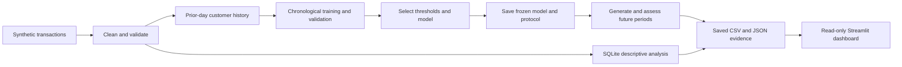
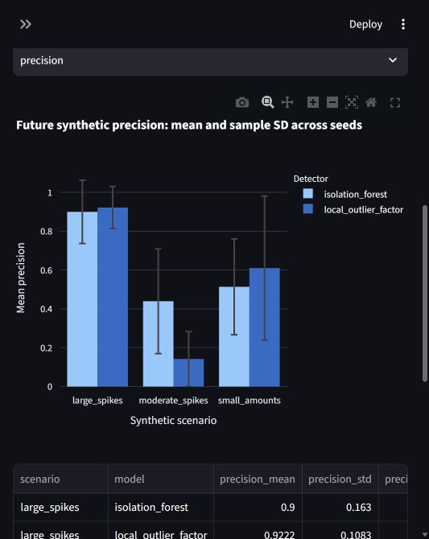

# Banking Transaction Intelligence & Anomaly Detection

[Live Streamlit dashboard](https://nicholelopez-banking-intelligence.streamlit.app/) | [GitHub repository](https://github.com/nicholelopez04/banking-transaction-intelligence)

A Python portfolio project that analyzes synthetic banking transactions with Pandas
and SQLite, builds customer history without look-ahead, and compares anomaly
detectors using chronological validation and frozen future assessments.

**All data is synthetic. Alerts identify unusual transactions for review, not
verified fraud. Synthetic injection metrics do not establish real-world fraud
quality.**

## What the project demonstrates

- Data cleaning, validation, SQL aggregation and customer spending analysis.
- Prior-only customer features with explicit handling for customers without history.
- Validation-based thresholds and feature/model selection, separated from assessment.
- Isolation Forest versus Local Outlier Factor across five seeds and three scenarios.
- A local Streamlit dashboard powered by saved CSV/JSON outputs, with interactive
  filters, rankings, confusion matrices and repeated-experiment charts.

## Quick start: Windows PowerShell, Python 3.12

The application lives in the existing nested project directory. Keep that directory
in place when using the supplied virtual environment; moving a Windows venv can
break its installed paths.

From this repository's root:

```powershell
Set-Location .\jpmorgan_transaction_project\jpmorgan_transaction_project
# Existing environment:
& .\.venv\Scripts\python.exe -m pip install -r requirements-lock.txt
& .\.venv\Scripts\python.exe main.py
& .\.venv\Scripts\python.exe -m streamlit run app.py --server.address 127.0.0.1 --server.port 8501 --server.headless true --browser.gatherUsageStats false
```

Open [the dashboard](http://127.0.0.1:8501). Stop the server with Ctrl+C. The default
`main.py` command runs the Phase 2 validation-only feature experiment.
Small saved Phase 1/2 reference fixtures accompany the source, so the dashboard
can open without rerunning the historical test. Nothing is published.

For a fresh checkout without an environment, run these first from the application
directory, then use the commands above:

```powershell
py -3.12 -m venv .venv
& .\.venv\Scripts\python.exe -m pip install -r requirements-lock.txt
```

`requirements.txt` lists direct dependencies and includes `requirements-lock.txt`, which pins the
complete environment verified with Python 3.12 on Windows; other platforms have
not been verified. No external account, database service or API key is required.

## Commands and output behavior

Run from the application directory:

| Command using `.\.venv\Scripts\python.exe` | Purpose | Output |
|---|---|---|
| `main.py` or `main.py --phase 2` | Prior-only feature comparison on validation | `outputs/phase2/` |
| `main.py --phase 1` | Reproduce the chronological threshold experiment, including the already-inspected historical test | `outputs/phase1/` |
| `main.py --phase 4` | Repeated validation selection, then frozen October assessment | New timestamped `outputs/phase4/` directory |
| `-m streamlit run app.py --server.address 127.0.0.1 --browser.gatherUsageStats false` | Read saved results in a local dashboard | No model output changes |
| `-B -m unittest discover -s tests -v` | Run unit and dashboard tests | Console results |
| `-m pip check` | Check installed dependency compatibility | Console results |

Phase 1/2 reruns replace files only inside their respective output directories.
Original baseline files beside `main.py` remain local and unchanged. Phase 4 retains
each run separately. Repeating a deterministic experiment reproduces the same
assessment data; it does not add independent evidence.

## Architecture and structure



```text
README.md                         Current setup, commands and measured results
.gitignore                        Local environments, secrets and artifact policy
docs/
  ARCHITECTURE.md                 Module responsibilities and data flow
  DATA_DICTIONARY.md              Actual data columns and feature definitions
  EVALUATION.md                   Splits, selection rules and limitations
  INTERVIEW_GUIDE.md              Plain-language explanations and talking points
  results/                       Compact recorded Phase 4 evidence and screenshot
sql/analysis.sql                  Read-only customer and daily aggregation examples
jpmorgan_transaction_project/
  jpmorgan_transaction_project/
    main.py                       Runnable CLI; original generator; Phase 1
    phase2.py                     Prior-only features and validation comparison
    phase4.py                     Repeated model comparison and frozen assessment
    app.py                        Dashboard views and controls
    dashboard_data.py             Saved-output loading and filtering
    requirements*.txt             Direct dependencies and exact version snapshot
    tests/                        Unit tests and Streamlit AppTest cases
    outputs/phase1/, phase2/       Small synthetic reference fixtures
    outputs/phase4/               Local generated runs, ignored by Git
    .venv/                        Existing local Python environment, ignored
```

The small flat application is intentional: no service framework, orchestration
system or package installation is needed. See [architecture](docs/ARCHITECTURE.md)
and the [data dictionary](docs/DATA_DICTIONARY.md).

## Measured results and their limits

The original fixed baseline had 995 cleaned rows, $110,110.12 in volume, 333 test
rows and four known injections. It produced 16 alerts: TP=4, FP=12, FN=0, TN=317;
precision=25%, recall=100%, precision@10=40%. These files were preserved.

Phase 1 introduced a 463-row training set and 199-row validation set. The chosen
threshold achieved perfect validation metrics on **two** injections, then produced
zero alerts on the 333-row historical test, missing all four injections. This
failed to generalize. The training window also changed, so the difference from
the original baseline cannot be attributed only to the threshold.

Phase 2 removed within-training look-ahead from the eligible feature sets. Both the
two-feature prior-ratio set and five-feature enhanced set achieved validation
F1=1.0 on the same two injections. The simpler set won the predeclared tie-break;
extra features showed no measured validation benefit. No Phase 2 test was scored.

Phase 4 selected Isolation Forest by mean validation F1 (0.6358 versus LOF 0.6076)
before generating October assessment periods. Future F1 mean +/- sample SD across
five seeds per scenario:

| Scenario | Isolation Forest F1 | LOF F1 |
|---|---:|---:|
| Large spikes | 0.797 +/- 0.104 | 0.692 +/- 0.181 |
| Moderate spikes | 0.307 +/- 0.169 | 0.169 +/- 0.152 |
| Small amounts | 0.546 +/- 0.246 | 0.580 +/- 0.302 |

These SDs describe seed variation, not confidence intervals. Every future period
had 498 usable transactions and eight known injections. Moderate-spike LOF alerts
ranged from 0 to 337, exposing unstable review workload. The frozen selection was
not changed after these results. Neither algorithm is uniformly better across
scenarios, and no statistical superiority is claimed.

Read [the complete Phase 4 report](docs/results/phase4_report.md) and
[precision/recall/F1/alert summaries](docs/results/future_summary.csv).
Results use new scenario data and are not a causal improvement comparison against
the original baseline.



## SQL and feature engineering

```sql
SELECT customer_id, COUNT(*) AS transaction_count,
       ROUND(SUM(amount), 2) AS total_spent
FROM transactions
GROUP BY customer_id
HAVING SUM(amount) > 2000
ORDER BY total_spent DESC
LIMIT 5;
```

`GROUP BY` forms customer groups; `HAVING` filters aggregated totals; `ORDER BY`
sorts the result. `WHERE` filters individual rows before aggregation.
More runnable queries are in [sql/analysis.sql](sql/analysis.sql). Phase 1 creates
`outputs/phase1/banking.db` and its cleaned `transactions` table. Full-period SQL
summaries are descriptive and are never fed into prior-only model features.

Selected model features are `log1p(amount)` and amount divided by the customer's
mean on strictly earlier days. The expanded candidate also uses log prior mean,
log prior count and a cold-start flag. Same-day transactions are excluded from one
another's history because dates have no time-of-day information. A customer with
no history uses a prior global average (fixed $1 if no earlier observations exist)
and a neutral personal ratio of 1. Scalers fit training rows only. See
[the evaluation methodology](docs/EVALUATION.md) for update and selection policies.

## Dashboard and testing

The six views cover overview, data quality, customer spending, anomaly ranking,
model evaluation and robustness. Transaction filters apply to descriptive views
and ranking; evaluation always uses the complete selected split. Historical Phase 1
test and Phase 2 validation metrics remain visibly separate. The threshold explorer
uses saved validation operating points without changing predictions or test results.
Precision displays N/A if there are no alerts. The robustness tab reads the latest
completed local run; the compact checked-in evidence remains in `docs/results/`.

Tests cover known threshold optima, tied scores, chronological boundaries,
prior-only history, same-day exclusion, future/label/order invariance, cold starts,
generator reproducibility, missing artifacts, model persistence, scaling, SQL
aggregation and dashboard interactions. See [final verification](docs/VALIDATION.md).

## Limitations and future work

- Injection labels mark deliberately perturbed amounts, not confirmed fraud. Other
  unusual transactions may be counted as false positives against these labels.
- Five seeds, 50 synthetic customers and a few positives do not establish deployment
  quality. Scenarios share underlying draws and are not independent populations.
- Customer means can be distorted by spikes; sparse histories remain noisy.
- Amount-only features omit merchant behavior, variability, device context and
  frequency patterns. Merchant category exists; transaction timestamps do not.
- The historical September test was already inspected. October was generated only
  after selection froze; it is now assessed and must not guide further tuning.
- F1 weights precision and recall equally and ignores banking review costs.
- Nonnegative-amount validation fits this generator; real refunds and reversals
  require explicit business handling. Missing amounts are excluded, not imputed.
- The dashboard reads local batch outputs; it is not a real-time payment system.

Future work: robust customer medians/variability, richer documented synthetic
scenarios, predeclared cost or review-budget objectives, and new untouched periods
for future model development. Real-world claims would require representative data
and reliable outcomes under appropriate access controls.

[Interview preparation](docs/INTERVIEW_GUIDE.md) explains the Python, Pandas, SQL
and ML decisions in plain language. The reviewed source and synthetic reference results are published on GitHub,
and the dashboard is deployed on Streamlit Community Cloud.


## Hosting

The [public dashboard](https://nicholelopez-banking-intelligence.streamlit.app/)
is deployed on Streamlit Community Cloud's free tier using Python 3.12.
The hosted app reads committed synthetic reference data and recorded robustness
evidence without training models or regenerating evaluation data. It may sleep
when inactive. See [deployment and live verification](docs/DEPLOYMENT.md).
