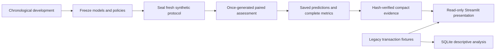

# Banking Transaction Intelligence & Anomaly Detection

[Public dashboard](https://nicholelopez-banking-intelligence.streamlit.app/) · [GitHub](https://github.com/nicholelopez04/banking-transaction-intelligence)

A Python, Pandas, SQLite and Streamlit portfolio study of leakage-safe customer history, anomaly ranking, review capacity and honest evaluation. The finished study demonstrates why independent evaluation matters: richer behavioral rules improved some synthetic detection results, but **neither frozen pipeline met the predefined hypothetical synthetic screening targets. Neither is production-ready.**

**All transactions and injection labels are synthetic. These results measure detection of deliberately injected rows, not verified real-world fraud. Non-injected rows are not verified legitimate transactions.**

The Stage 5 presentation was published in [commit d5879b7893ea0a8088f954dd6e062769bbae8b58](https://github.com/nicholelopez04/banking-transaction-intelligence/commit/d5879b7893ea0a8088f954dd6e062769bbae8b58) and verified live on October 27, 2026. The existing Streamlit Community Cloud app completed a Linux/Python 3.12.15 build. Live checks covered Stage 5 metrics, scenario charts, customer filters, transaction exploration, rankings and historical results; the public case-results download matched the saved evaluation output byte-for-byte.

An initial `ImportError` for `load_independent` cleared after rebooting the existing app, without changing code or experiment results. Streamlit's build automatically substituted PyArrow 24.0.0 for pinned 26.0.0 as a provider compatibility fix; the repository's dependency files remain unchanged. See [deployment and verification details](docs/DEPLOYMENT.md).

## Final independent study

Stage 5 assessed two frozen pipelines on identical new transactions: eight scenarios × five seeds = 40 cases, 800,000 scored transactions, 200,000 warmup transactions, 5,400 injected rows and 4,181 injected events. All final cases were generated once after protocol sealing. No test-driven retuning or reselection occurred.

### Native frozen review policies

| Pipeline | TP | FP | FN | TN | Reviews | Precision | Recall | F1 |
|---|---:|---:|---:|---:|---:|---:|---:|---:|
| Phase 2 | 0 | 83 | 5,400 | 794,517 | 83 | 0% | 0% | 0% |
| Phase 6 v1 rules_B | 462 | 4,722 | 4,938 | 789,878 | 5,184 | 8.912% | 8.556% | 8.730% |

Phase 2 uses training-only StandardScaler and Isolation Forest on two amount features, with score **>= 0.1617068977463595**. Phase 6 uses five empirical-CDF behavioral rules, score **> 0.99945009150821**, followed by an end-of-day review queue capped at 100 reviews per 10,000 transactions. These are different native policies and workloads, not real-time blocking systems.

**452 of Phase 6's 462 native detections (97.8%) were inactivity returns.** Only ten detections covered the other four injection types combined. All seven positive scenarios failed the 20% mean-recall target for both models. Phase 6 passed the 10% scenario-pooled precision target only in S4 and S6 and failed all five no-injection controls: 159, 150, 141, 149 and 140 reviews against a maximum of 100. Both models stayed within the overall 200-review-per-case capacity. These benchmarks are hypothetical research screens, not JPMorgan requirements or banking standards.

### Equal-budget ranking only

Exactly 200 reviews per 20,000-row case, or **8,000 reviews per pipeline**, including control cases. This assessment ranks scores under the predefined daily budget, including below-threshold rows. It does not replace native-policy results.

| Pipeline | TP | FP | FN | TN | Precision | Recall | F1 |
|---|---:|---:|---:|---:|---:|---:|---:|
| Phase 2 | 78 | 7,922 | 5,322 | 786,678 | 0.975% | 1.444% | 1.164% |
| Phase 6 v1 | 507 | 7,493 | 4,893 | 787,107 | 6.338% | 9.389% | 7.567% |

Phase 6 lost to Phase 2 on equal-budget recall in contextual amounts (3.5% versus 4.5%) and spending ramps (0.8% versus 1.0%). Its aggregate gain is not broad detection adequacy or an algorithm-only causal improvement.

See the [complete final report](docs/results/stage5/REPORT.md), [all 160 case/policy results](docs/results/stage5/all_case_metrics.csv), [scenario variability](docs/results/stage5/scenario_variability.csv), [screening outcomes](docs/results/stage5/native_screening_by_scenario.csv), and [evidence hashes](docs/results/stage5/evidence_manifest.json). The dashboard shows every scenario and failure.

## Historical evidence remains visible

**Model Selection Only — Two Injected Anomalies:** the Phase 2 validation precision and recall were 100%, on just two injected positives reused for features and threshold selection. Those metrics were not independent performance. A separate earlier independent study detected 0 of 3,000 injected rows. Phase 6's later development audit recall was 2.39%; its frozen rules_B selection did not imply success. Earlier Isolation Forest/LOF robustness results remain [historical development evidence](docs/results/phase4_report.md).

## Run the saved-results dashboard

Windows PowerShell, from the repository root:

```powershell
Set-Location .\jpmorgan_transaction_project\jpmorgan_transaction_project
# Only for a fresh checkout without an environment:
py -3.12 -m venv .venv
& .\.venv\Scripts\python.exe -m pip install -r requirements-lock.txt
& .\.venv\Scripts\python.exe -m streamlit run app.py --server.address 127.0.0.1 --server.port 8501 --server.headless true --browser.gatherUsageStats false
```

If the supplied Python 3.12 environment already exists, reuse it and omit environment creation. Open [localhost](http://127.0.0.1:8501). No API keys, external accounts or database service are needed locally. Do not run `main.py` to launch the dashboard: all required saved evidence accompanies the publication bundle. Legacy experiment commands can replace historical output files and belong in a separate scratch checkout, not the accepted archive.

For Linux, use Python 3.12, `python3.12 -m venv .venv`, `.venv/bin/python -m pip install -r requirements-lock.txt`, then `.venv/bin/python -m streamlit run app.py`. Paths resolve from source-file locations. The hosted Linux/Python 3.12.15 build and live dashboard were verified successfully; note the provider's PyArrow substitution described in [deployment notes](docs/DEPLOYMENT.md).

## Explore and explain the project

The dashboard opens with final independent results, all scenarios, screening gates and provenance. Existing views retain transaction overview charts, data quality, customer filters, customer spending, saved anomaly rankings, historical selection metrics and historical robustness charts. Explorer filters apply only to legacy transactions; they cannot alter final-study denominators. The historical threshold slider explores saved validation operating points without changing predictions.

SQLite customer/daily aggregation functionality and [SQL examples](sql/analysis.sql) remain unchanged. `GROUP BY` creates customer groups; `HAVING` filters totals after aggregation; `WHERE` filters individual rows. Full-period SQL summaries are descriptive, never inputs to historical model features. Databases stay local; SQL tests create temporary databases.

```powershell
& .\.venv\Scripts\python.exe -B -m unittest discover -s tests -v
& .\.venv\Scripts\python.exe -m pip check
```

The complete local research suite includes fixture-only model fits and generator tests. It does not regenerate final cases. The compact public bundle includes the dashboard and legacy tests plus presentation tests; archive-dependent research tests remain local with their required evidence. Local checks and the exact 83-file publication allowlist are recorded in [the historical pre-publication review](docs/PORTFOLIO_PUBLICATION_REVIEW.md); completed build and live checks are recorded in [deployment notes](docs/DEPLOYMENT.md).

## Architecture and evidence policy



The application is in `jpmorgan_transaction_project/jpmorgan_transaction_project/`. `app.py` preserves explorer views; `dashboard_evaluation.py` presents final evidence; `dashboard_data.py` loads saved data and checks exported hashes. Small synthetic Phase 1/2 fixtures support legacy views; `docs/results/stage5/` contains compact final evidence. Full final datasets, predictions, model binaries, backup archives, environments, secrets and logs remain outside the published allowlist.

Limitations include synthetic label ambiguity, only five seeds per fixed scenario, generator authors' knowledge of model families, distribution assumptions, and narrow feature coverage. Paired bootstrap intervals are conditional descriptions, not real-world guarantees. The models differ in training data, temporal resolution and review policies. No further development or Phase 6 v2 is included.

Read the [evaluation methodology](docs/EVALUATION.md), [interview guide](docs/INTERVIEW_GUIDE.md), and [historical architecture](docs/ARCHITECTURE.md). The updated dashboard is deployed on the existing Streamlit Community Cloud application. Full research evidence is preserved locally with verified checksums; the public dashboard is a read-only evidence viewer. No models were retrained or experimental artifacts changed for deployment.
